# Bank Account – CQRS & Event Sourcing avec Axon Framework

**Réalisé par : Majri Salma**
**Module :** Systèmes Distribués et DevOps 2026 – Activité Pratique N°4
**Encadrant :** Pr. Mohamed YOUSSFI

---

## Présentation

Ce projet est une application de gestion de comptes bancaires qui implémente les patterns d'architecture **CQRS** (Command Query Responsibility Segregation) et **Event Sourcing** avec **Spring Boot**, **Axon Framework** et **Axon Server**.

L'application permet de :
- créer un compte (activé automatiquement après sa création) ;
- effectuer des opérations de **crédit** et de **débit** ;
- modifier le **statut** d'un compte ;
- consulter l'**historique des événements** d'un compte ;
- consulter la liste des comptes et le **relevé** (statement) d'un compte ;
- suivre les opérations d'un compte en **temps réel** (Server-Sent Events).

## Architecture

### Côté Commande (Command Side)
- Les requêtes REST arrivent dans `AccountCommandController`, qui envoie des commandes via le `CommandGateway`.
- L'agrégat `AccountAggregate` applique les règles métier (solde initial positif, compte activé, solde suffisant) dans ses `@CommandHandler`, puis publie des événements avec `AggregateLifecycle.apply()`.
- Les `@EventSourcingHandler` font évoluer l'état de l'agrégat à partir des événements.
- Les événements sont enregistrés dans l'**Event Store** (PostgreSQL, puis Axon Server).

**Commandes :** `AddAccountCommand`, `CreditAccountCommand`, `DebitAccountCommand`, `UpdateAccountStatusCommand`

**Événements :** `AccountCreatedEvent`, `AccountActivatedEvent`, `AccountCreditedEvent`, `AccountDebitedEvent`, `AccountStatusUpdatedEvent`

### Côté Lecture (Query Side)
- `AccountEventHandler` (`@EventHandler`) projette les événements dans une base relationnelle de lecture (entités JPA `Account` et `AccountOperation`).
- `AccountQueryController` envoie les requêtes (`GetAllAccountsQuery`, `GetAccountStatementQuery`, `WatchEventQuery`) via le `QueryGateway`.
- `AccountQueryHandler` (`@QueryHandler`) lit les données projetées et retourne les DTOs.

### Temps réel (SSE)
- Un endpoint `watch` retourne un `Flux<AccountOperation>` (Project Reactor).
- Le `QueryUpdateEmitter` pousse chaque nouvelle opération (crédit / débit) vers le client.

### Distribution avec Axon Server
- Axon Server centralise l'Event Store et le dispatching des commandes, événements et requêtes via gRPC.

### Schéma global du fonctionnement

```
                 ┌─────────────────────────┐
                 │       Client REST       │
                 │  (Swagger / Web Client) │
                 └────────────┬────────────┘
                              │
            ┌─────────────────┴─────────────────┐
            │                                   │
[Command Side (Écriture)]            [Query Side (Lecture)]
            │                                   │
            ▼                                   ▼
┌───────────────────────┐           ┌───────────────────────┐
│     CommandGateway    │           │      QueryGateway     │
└───────────────────────┘           └───────────────────────┘
            │                                   │
            ▼                                   ▼
┌───────────────────────┐           ┌───────────────────────┐
│    AccountAggregate   │           │  AccountQueryHandler  │
│    @CommandHandler    │           │     @QueryHandler     │
│ @EventSourcingHandler │           └───────────────────────┘
└───────────────────────┘                       │
            │  AggregateLifecycle.apply()       │
            ▼                                   │
┌───────────────────────┐                       │
│      EVENT STORE      │                       │  lecture
│     (Axon Server)     │                       │
└───────────────────────┘                       │
            │  Event Projection                 │
            ▼                                   ▼
┌───────────────────────┐           ┌───────────────────────┐
│  AccountEventHandler  ├──────────▶│   Base Relationnelle  │
│     @EventHandler     │           │   (PostgreSQL / JPA)  │
└───────────────────────┘           └───────────────────────┘
```

**Explication du flux :**

1. **Écriture** : le client envoie une requête REST → le contrôleur la transforme en **commande** → l'**agrégat** vérifie les règles métier (solde positif, compte activé, solde suffisant) → il publie un **événement** qui est enregistré dans l'**Event Store** d'Axon Server.
2. **Projection** : l'événement est diffusé à l'`AccountEventHandler`, qui met à jour la **base de lecture** (comptes et opérations).
3. **Lecture** : le client envoie une **requête** (liste des comptes, relevé) → le `QueryHandler` lit la base de lecture et retourne le résultat. L'écriture et la lecture sont donc **séparées** (CQRS).
4. **Temps réel** : à chaque crédit ou débit, le `QueryUpdateEmitter` pousse l'opération vers le client connecté à l'endpoint `watch` (SSE).
5. **Event Sourcing** : l'état d'un compte n'est pas stocké directement, il est **reconstruit en rejouant tous ses événements** (`Created → Activated → Credited → Debited ...`).

## Technologies

- Java 17, Spring Boot (Spring Web, Spring Data JPA)
- Axon Framework + Axon Server
- PostgreSQL + PgAdmin (Docker Compose)
- Project Reactor (Flux / SSE)
- Lombok, Jackson
- SpringDoc OpenAPI (Swagger UI)

## Lancement

1. Cloner le projet :
   ```bash
   git clone https://github.com/Salma-Majri/bank-account-cqrs-axo.git
   cd bank-account-cqrs-axo
   ```
2. Démarrer PostgreSQL, PgAdmin et Axon Server :
   ```bash
   docker compose up -d
   ```
3. Lancer l'application Spring Boot (port **8086**).
4. Interfaces utiles :
    - Swagger UI : `http://localhost:8086/swagger-ui.html`
    - Axon Server Dashboard : `http://localhost:8024`

## Endpoints

| Méthode | URL | Description |
|---------|-----|-------------|
| POST | `/commands/accounts/add` | Créer un compte |
| POST | `/commands/accounts/credit` | Créditer un compte |
| POST | `/commands/accounts/debit` | Débiter un compte |
| PUT | `/commands/accounts/updateStatus` | Modifier le statut d'un compte |
| GET | `/commands/accounts/events/{accountId}` | Historique des événements d'un compte |
| GET | `/query/accounts/all` | Liste de tous les comptes |
| GET | `/query/accounts/accountStatement/{accountId}` | Relevé d'un compte |
| GET | `/query/accounts/watch/{accountId}` | Suivi en temps réel (SSE) |

---

## Démonstration

### 1. Command Side

#### Création d'un compte
Requête `POST /commands/accounts/add` avec un solde initial de 1000 MAD :

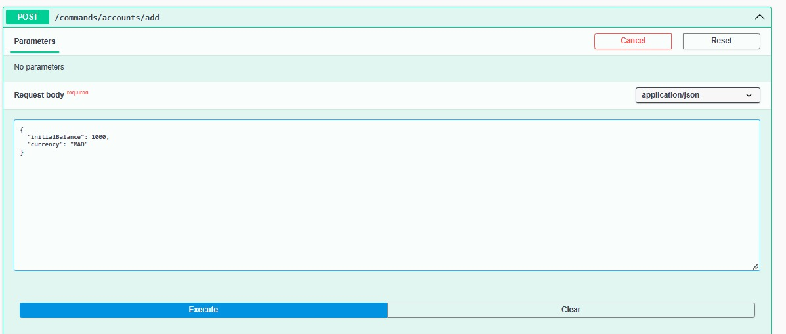

La réponse retourne l'identifiant (UUID) du compte créé :

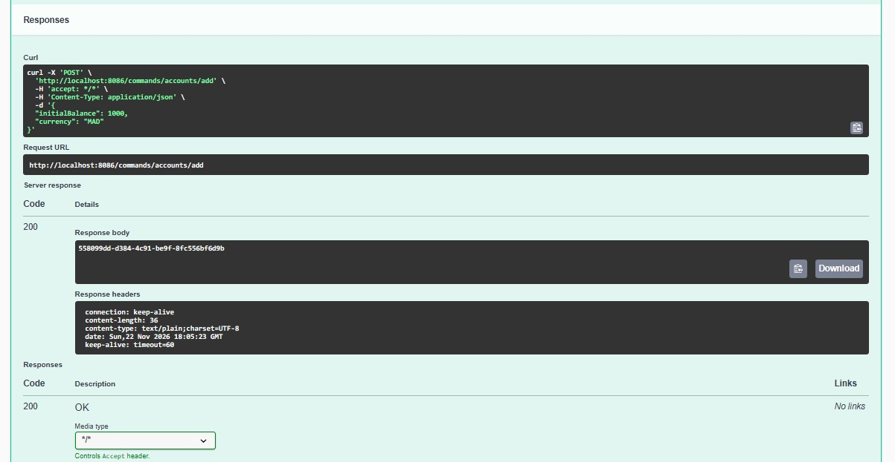

#### Crédit d'un compte
Requête `POST /commands/accounts/credit` (500 MAD) :

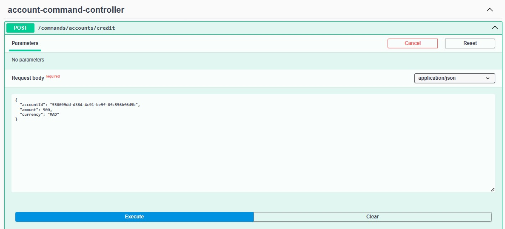

Réponse du serveur (200 OK) :

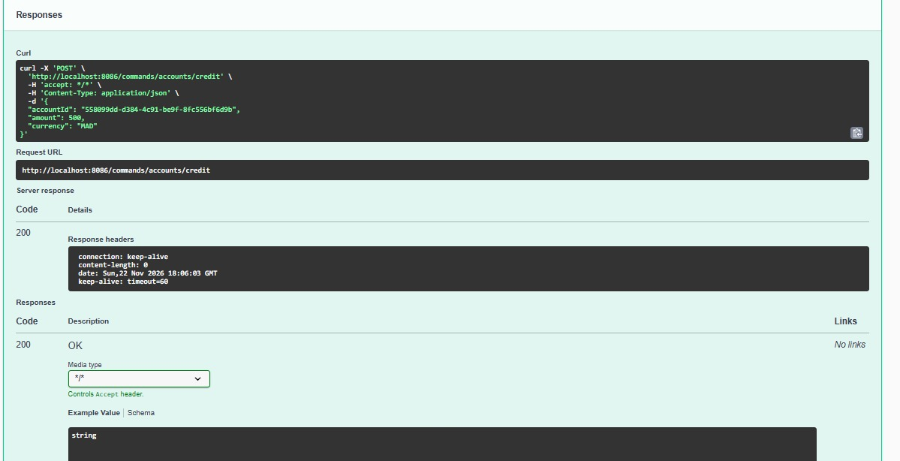

#### Consultation de l'historique des événements
Requête `GET /commands/accounts/events/{accountId}` :

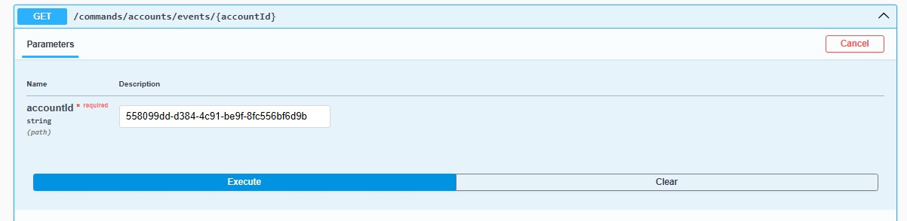

On retrouve les événements `AccountCreatedEvent` et `AccountActivatedEvent` (avec `sequenceNumber`, `payload`, `metaData`) :

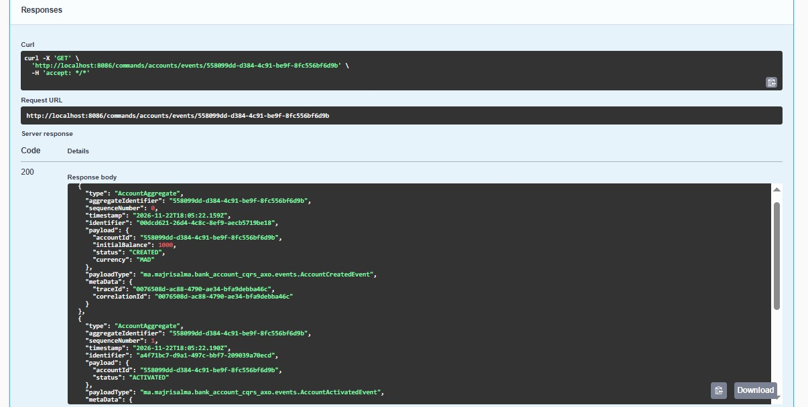

#### Débit d'un compte – règle « solde suffisant »
Tentative de débit de 1000 MAD :

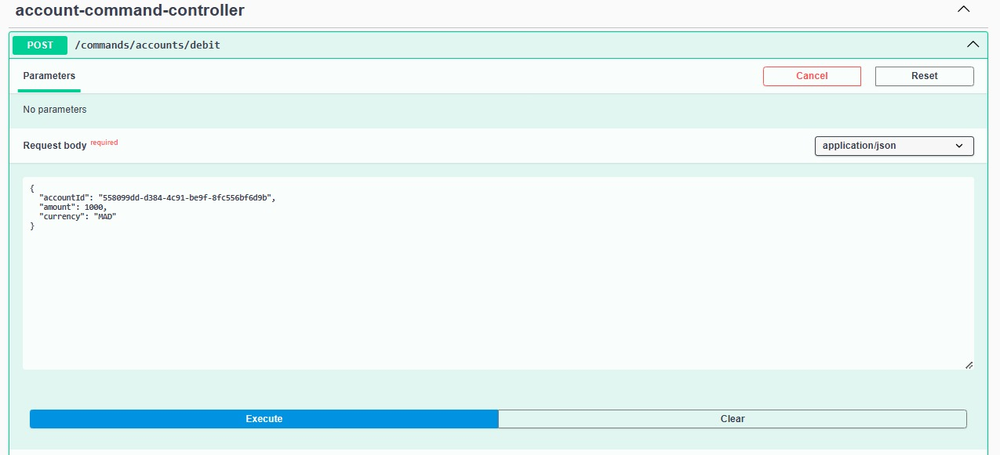

Le débit est refusé car le solde est insuffisant (`Balance Not sufficient Exception`) :

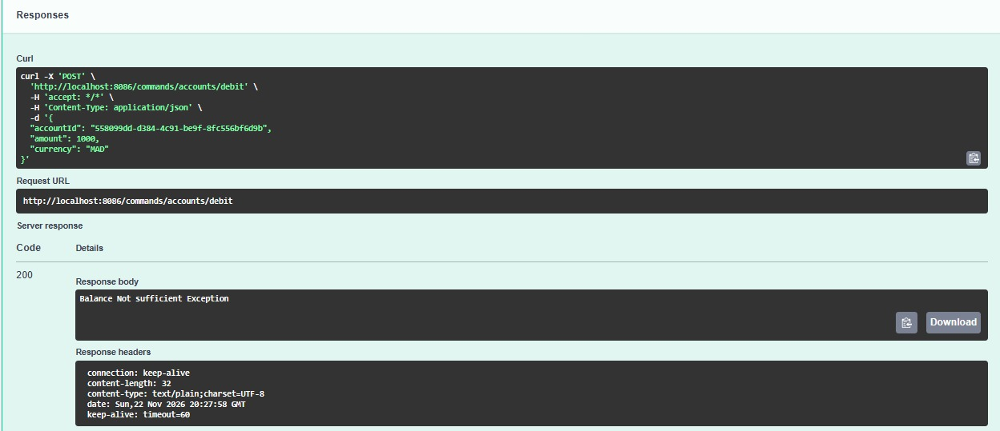

#### Modification du statut
Requête `PUT /commands/accounts/updateStatus` (statut `SUSPEND`) :

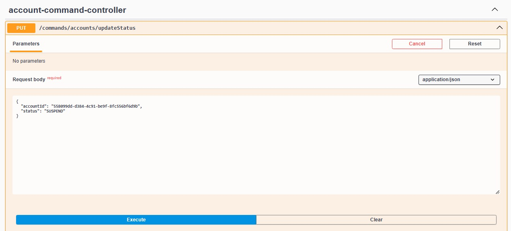

Réponse du serveur (200 OK) :

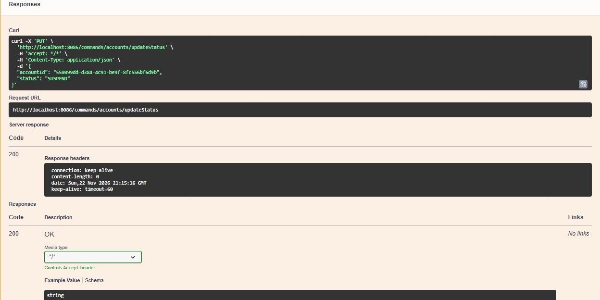

#### Event Sourcing : historique complet dans l'Event Store
Les événements `AccountDebitedEvent` et `AccountStatusUpdatedEvent` sont bien enregistrés :

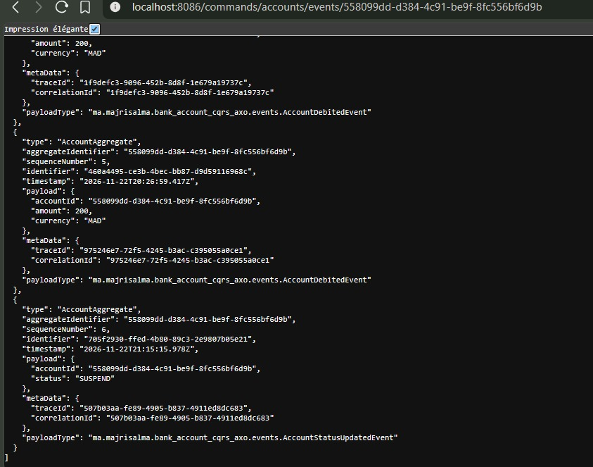

#### Débit d'un compte suspendu – règle « compte activé »
Le débit est refusé car le compte n'est pas activé (statut courant : `SUSPEND`) :

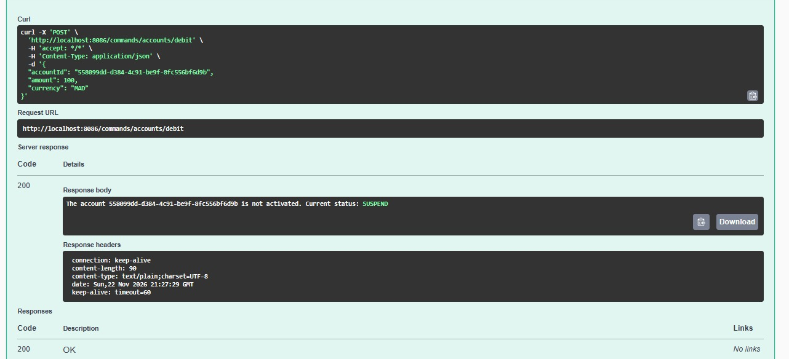

### 2. Query Side

#### Liste de tous les comptes
`GET /query/accounts/all` :

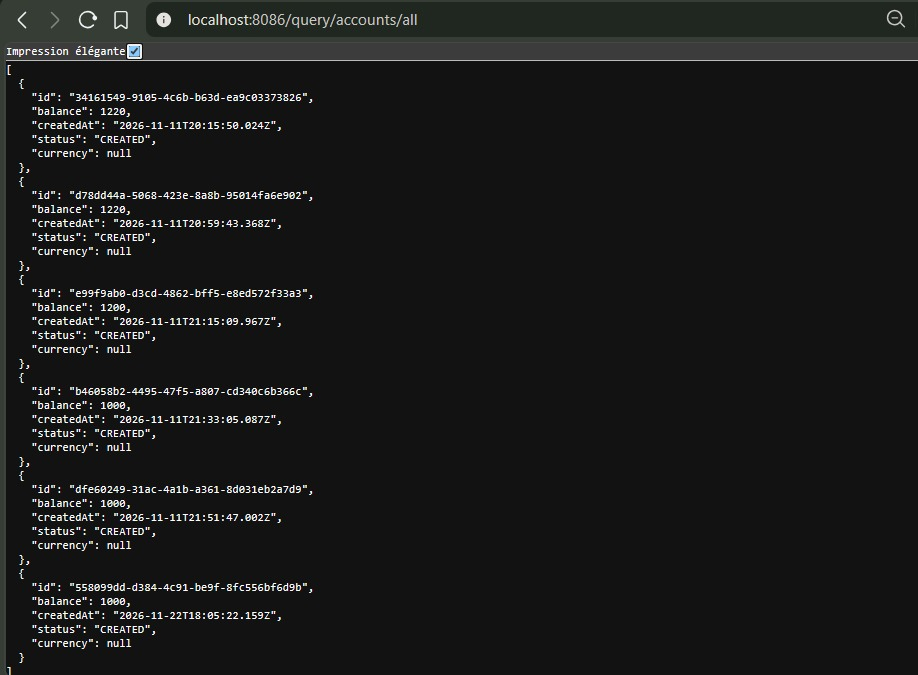

#### Relevé d'un compte
`GET /query/accounts/accountStatement/{accountId}` : le compte et ses opérations :

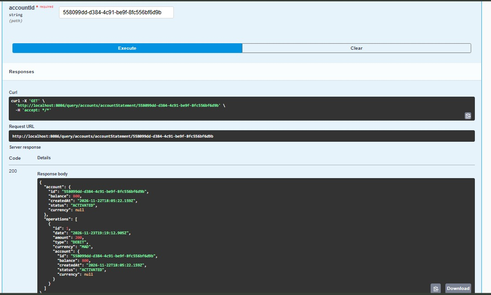

### 3. Temps réel (SSE)

`GET /query/accounts/watch/{accountId}` : les opérations de crédit et de débit sont reçues en direct :

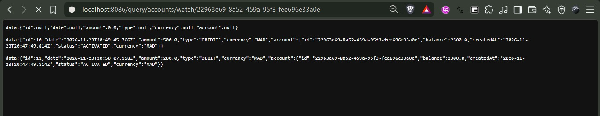

### 4. Axon Server

#### Vue d'ensemble
L'application `bank-account-cqrs-axo` est connectée à Axon Server :

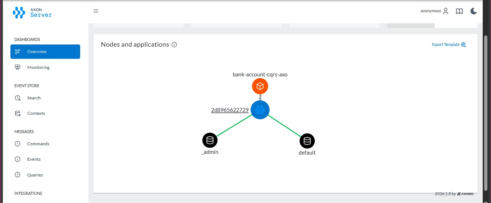

#### Event Store
Recherche des événements stockés dans Axon Server (`AccountCreatedEvent`, `AccountActivatedEvent`, `AccountCreditedEvent`) :

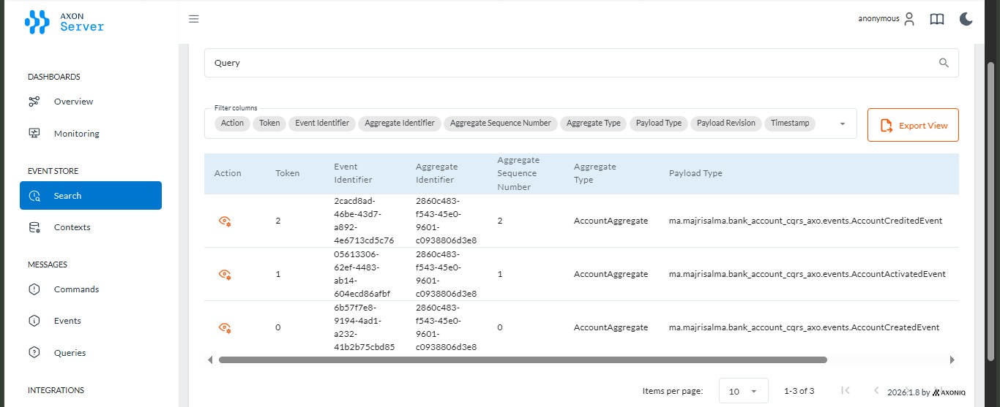

---

## Auteur

**Majri Salma**
GitHub : [Salma-Majri](https://github.com/Salma-Majri)